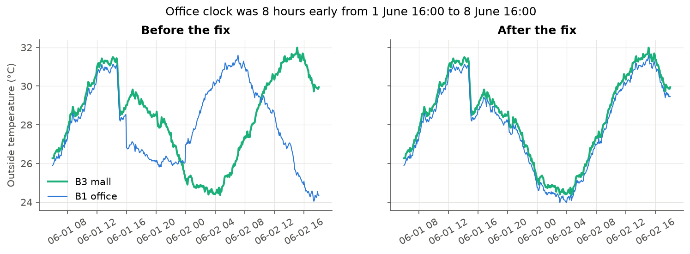
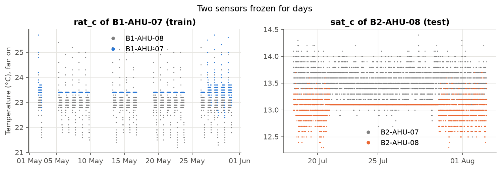

# Data quality

Back to the [project map](00%20-%20Project%20map.md).

This note lists each data problem I found, how I found it, what I did, and what I would ask the building operator. The details and charts are in `notebooks/02_data_quality.ipynb`. All fixes run together in `clean_sensors()` (`src/ahu_fdd/data.py`), on train and test.

First look (from `notebooks/01_data_overview.ipynb`). The diary should work like an attendance list: one row per machine every 5 minutes. In train, each building breaks it in its own way, and in the same way for all its machines:

| Building | Duplicate rows (same time twice) | Missing slots (no row) |
|---|---|---|
| B1 office | In all 16 machines, up to 96 per machine (8 hours), all on 1 June | about 0.5% |
| B2 hospital | none | **about 4.9% in every machine (around 9 days)** |
| B3 mall | In all 12 machines, up to 288 per machine (one full day: 14 February), copies identical in 98% of cases | about 0.3% |

- A problem shared by every machine of a building points to how each BMS exported or stored the data, not to a broken sensor.
- Test is clean: no duplicates and about 0.3% missing slots everywhere.
- About 0.2% nulls in some sensors in train, none in test.

## One office week stamped 8 hours early

From 2 to 8 June, the office (B1) data is saved in UTC instead of Singapore time (UTC+8). In plain words: the clock of the office diary was 8 hours early that week.

- The office seems to run from 23:00 to 11:30 instead of 07:00 to 19:30, and the outside temperature peaks around 07:00 instead of 14:00.
- Where the shifted block starts, 8 hours of 1 June appear twice with different values: these are the 96 "duplicates" per office machine. Where it ends, 8 June has an 8-hour hole.
- The mall runs normally that week, so it only affects the office.
- Proof (`notebooks/02_data_quality.ipynb`, section 1): the three buildings share the same weather. In that week the office outside temperature matches the mall temperature 8 hours later (0.4 °C gap), not at the same time (3.6 °C gap). Trying every offset from -12 to +12 hours, the best one is exactly +8.
- In each duplicate pair, the first copy in the file is the real 1 June evening and the second copy is the early-clock 2 June night.
- Fix: `fix_clock_shift()` in `src/ahu_fdd/data.py` adds 8 hours to the office rows stamped from 1 June 16:00 to 8 June 16:00 (only the second copy in the first 8 hours). 13 stamps in those first 8 hours have only one row, so I can't tell which clock they belong to: I drop them. The limits are in `config.py`.
- Result: no office duplicates left, missing slots drop from 0.5% to 0.3%, and the 8 June hole is filled. Only the 13 ambiguous rows are dropped. No office fault event falls in that week.

## One mall day saved twice

Every mall (B3) machine has Friday 14 February twice. In plain words: the same page of the diary was copied into the file two times.

- 97.9% of the pairs are exact copies. In the other 72 pairs, one sensor value is empty (NaN) in one copy and filled in the other. The two copies never give two different numbers.
- It looks like the same day was exported twice, each time losing a few different values (about the same 0.2% of nulls I see in all the train data).
- Fix: `merge_duplicates()` in `src/ahu_fdd/data.py` keeps one row per machine and stamp, and fills an empty value in one copy with the value of the other. It recovers the 73 empty values of that day.
- It runs after `fix_clock_shift()`. Before that fix, the office "duplicates" are two different hours and must not be merged.
- Result: no duplicates left in any building. 3,452 rows removed in total (3,439 mall copies and 13 ambiguous office rows).

## Hospital data lost for 8 days

Every hospital (B2) machine misses about 4.9% of its slots. In plain words: the diary has a few pages torn out, the same pages in every machine.

- `gap_blocks()` in `src/ahu_fdd/eda.py` joins consecutive missing 5-minute slots into blocks.
- The hospital has one block of 200 hours (about 8.3 days), from Monday 10 March 06:00 to Tuesday 18 March 13:55 (last missing slot), in all 12 machines at the same time. One sensor would fail in one machine; this hits the whole building, so the BMS or its network stopped saving.
- No hospital fault event falls in that gap, so no label is lost.
- All other gaps, in every building and in train and test, are 5 or 10 minutes long (about 0.3% of the slots).
- Decision: I don't fill the 8-day gap (no data to fill it from) or the short gaps. Features will use time-based windows, so a missing slot only means one value less in the window.

## Values I can't trust

Sections 1 to 3 were about rows. Here I look inside the rows.

| Problem | Where | What I did |
|---|---|---|
| About 0.2% empty values in fan power, three temperatures and the valve | all buildings, train only | Keep them as NaN |
| Fan power logged in watts instead of kW (40 instead of 0.04 with the fan off) | B3-AHU-04, 1 to 21 April | Divide by 1,000 (`fix_power_units()`) |
| CO2 at exactly 0 or 5,000 ppm, the limits of the sensor | B2-AHU-03, 20 Jan to 27 Feb, 781 rows | Set to NaN (`blank_co2_limits()`) |
| Return air temperature frozen at 23.4 °C for 22 days | B1-AHU-07, 5 to 26 May (train) | Set to NaN (`blank_frozen()`) |
| Supply air temperature frozen at 13.1 °C for 9 days | B2-AHU-08, 21 to 29 July (test) | Set to NaN (`blank_frozen()`) |

- A frozen sensor: a real temperature always moves a little. Normal sensors never stay at exactly the same value for more than about 1.5 hours. I blank a temperature that stays flat for 6 hours or more.
- The frozen `sat_c` in test is important: it sits 0.1 °C above its setpoint, so the machine looks perfect on that sensor. It's not one of the four faults, so the model must not raise an alarm there.
- Fan status, speed, power and static pressure always agree (zero rows break the rules), so the fan status is a reliable filter for the scored rows.

