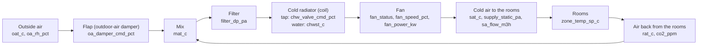
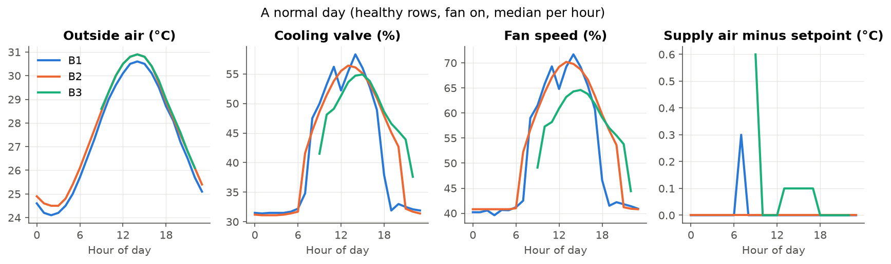
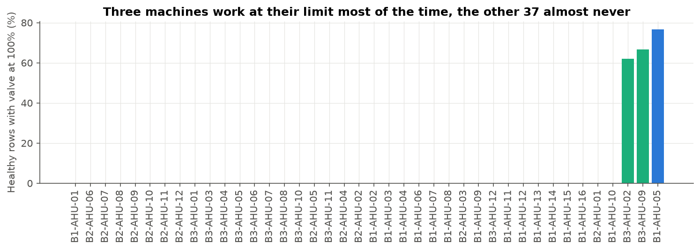
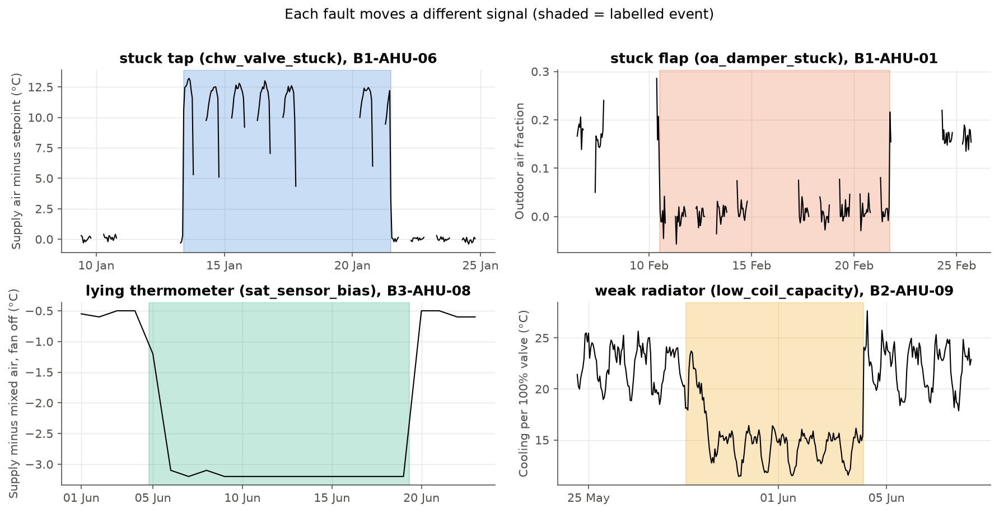

# AHU physics and faults

Back to the [project map](00%20-%20Project%20map.md).

This note explains, in plain words, how the air works in these buildings and what each fault means. The technical details come after the simple version.

## The problem: keep a hot building cool

Think of a shopping mall in Singapore. Outside it is about 30 °C and very humid all year. Inside there are thousands of people, lights and shop windows that also give off heat. To keep people comfortable (about 24 °C), the building has to cool its air all the time.

## The solution: the AHU, the "lungs" of the building

An AHU (air handling unit) is a big machine, about the size of a van, on the roof or in the basement. Its job is to take air, cool it and send it to the rooms through the ducts in the ceiling. The grilles you see in a mall ceiling are where that air comes out.

A big building has several AHUs, each one for a zone. In this data the mall has 12: one for the cinema foyer, one for the food court, one for the shops on level 1, and so on. In total there are 40 AHUs in three buildings (an office, a hospital and a mall).

It works like the air conditioning of a car, just much bigger.

## What the AHU does, step by step

1. **Mix.** The machine takes the used, slightly warm air coming back from the rooms and adds a little air from outside to renew it. Without fresh air, CO2 would go up and people would feel stuffy. A **flap** (the outdoor-air damper) decides how much outside air comes in. Outside air in Singapore is very hot, so the flap stays mostly closed, like the "recirculate" button in a car.
2. **Filter.** Cleans the dust. Over time it gets dirty and the air has a harder time passing through.
3. **Cold radiator** (the cooling coil). A radiator with very cold water inside (about 7 °C) that comes from a central plant in the building. The air passes through it and cools down. A **tap** (the chilled-water valve) sets how much cold water goes through: more open tap, colder air.
4. **Fan.** Pushes the air through the ducts to the rooms.
5. **Cold air to the rooms**, at about 13–14 °C. It mixes with the room air and keeps the room at about 24 °C. Then that air goes back to the machine and the cycle starts again.

The whole path, with the data columns in each box:

| Step | Plain name | Technical name | Columns |
|---|---|---|---|
| 1 | Mix, with the flap | Mixing box, outdoor-air damper | `oat_c`, `oa_rh_pct`, `rat_c`, `oa_damper_cmd_pct`, `mat_c`, `co2_ppm` |
| 2 | Filter | Filter | `filter_dp_pa` |
| 3 | Cold radiator, with the tap | Chilled-water coil and valve | `chw_valve_cmd_pct`, `chwst_c` |
| 4 | Fan | Supply fan | `fan_status`, `fan_speed_pct`, `fan_power_kw` |
| 5 | Cold air to the rooms | Supply air | `sat_c`, `sat_sp_c`, `supply_static_pa`, `supply_static_sp_pa`, `sa_flow_m3h` |

## The two automatic "thermostats"

The machine has two automatic controls, like the thermostat at home:

| Control | What it watches | What it moves | Example |
|---|---|---|---|
| Temperature control | The temperature of the air going out (`sat_c`) | The **tap** of cold water (`chw_valve_cmd_pct`) | "The air goes out at 15 °C and I want 13 °C (`sat_sp_c`), so I open the tap more" |
| Pressure control | The pressure inside the duct (`supply_static_pa`) | The **fan speed** (`fan_speed_pct`) | "The pressure is too low, so I speed up the fan" |

**The key to understanding the faults:** the data stores what the control **asks for** ("open the tap to 80%"), not what the part really does. If the tap is stuck, the control keeps asking but nothing changes. **Finding a fault means catching that contradiction between what is asked and what happens.**

A few more things to know:
- In the office and the hospital, the flap also opens more when CO2 goes up (more people, more fresh air needed).
- When the fan is off, no air moves and the sensor values mean little. Only rows with the fan on are scored.

## What a healthy machine does

From `notebooks/03_patterns.ipynb` (cleaned data, fan on, no fault label). A fault is a change from this normal, so I need to know how much normal already moves.

- **A normal day:** the valve and the fan follow the outside temperature and the people inside. The valve is about 30% at night and 60% in the afternoon. The office dips at 12:00 (lunch). The supply air stays near its setpoint.
- **Setpoints:** each machine has one fixed supply air setpoint, but they differ between machines (12.5 to 14.5 °C). So I always use the error `sat_c - sat_sp_c`, not `sat_c`.
- **Start-up:** in the first 15 minutes after the fan starts, the supply air is about 5 °C above its setpoint. After 30 minutes it's on target. It looks like a weak radiator, but it's just a cold start. No alarms in the first 30 minutes.
- **Storms:** about two per week, in the afternoon. Outside air falls 3 °C in minutes and the valves close a bit.
- **Three machines always at their limit:** B1-AHU-05 (lobby), B3-AHU-02 (cinema foyer) and B3-AHU-09 (retail L2) have the valve at 100% and the air about 2 °C too warm in 60-80% of their healthy rows, every month. They are probably too small for their zones. A global rule would alarm on them every day, so the model must compare each machine with its own normal.
- **Normal drifts:** filters get dirty for months (the pressure drop goes up) and then are replaced (it falls in one day). So I validate in time order and don't use absolute filter or fan power values.
- **Test looks like train:** Singapore has almost no seasons. July and August are about 0.3 °C warmer.

## The four faults, in plain words

Each fault is one part of the machine failing. I give each one a plain name to remember it:

| Plain name | Label in the data | What breaks | Everyday example | How it should show in the data |
|---|---|---|---|---|
| **Stuck tap** | `chw_valve_stuck` | The cold water valve | A shower tap that doesn't turn: you move the handle and the water stays the same | The control asks for more or less cooling, but the air temperature doesn't change. The command often ends at 0% or 100%, trying to fix it |
| **Stuck flap** | `oa_damper_stuck` | The outdoor-air damper, stuck nearly closed | A car window that won't open: you want fresh air and none comes in | The mixed air is the same as the air coming back from the rooms, because no outside air enters, even if the flap is told to open. In the office and the hospital, CO2 goes up |
| **Lying thermometer** | `sat_sensor_bias` | The supply air temperature sensor | A home thermometer that reads 2 degrees too low: the heating thinks it's cold and heats too much | Tricky: the control trusts the sensor, so everything looks perfect. I have to catch it indirectly: the tap is more open (or closed) than usual for the load, the cooling across the coil doesn't match, or the rooms are colder or warmer than expected |
| **Weak radiator** | `low_coil_capacity` | The cooling coil (dirty, air inside, a valve half closed) | A home radiator with air inside: you open it fully and it barely gets warm | The tap is very open and the air still doesn't get cold enough, mostly when it's hot outside or the building is full |

Two questions to keep apart:
- **Detection:** is something wrong?
- **Diagnosis:** what is wrong?

Some faults can look alike with these sensors. A stuck tap and a weak radiator can both end with "tap very open, air not cold enough". If the data can't separate them, I say it.

## What the labelled events show

From `notebooks/04_faults.ipynb`. I compare each event with the healthy rows of the same machine (fan on, after the 30-minute start-up). The signals come from `src/ahu_fdd/features.py`.

In plain words: notebook 03 is the doctor learning your normal temperature, and notebook 04 is learning the symptoms of each illness. The good news is that each fault gives a different symptom, like the flu gives fever and a cold gives a runny nose.

| Plain name | Signal that moves | Typical change | Notes |
|---|---|---|---|
| Stuck tap | Supply air error, valve command | +4 to +12 °C (stuck nearly closed) or -4.5 to -5.6 °C (stuck open); command runs to 100% or 0% | 97% of event rows are more than 2 °C off target |
| Stuck flap | Outdoor air fraction, flap command, CO2 | fraction falls by about 0.10 to almost 0; command +40 points; CO2 +440 to +1,030 ppm | In the mall (no CO2 sensor) only the fraction shows it |
| Lying thermometer | Offset at rest: supply minus mixed air with the fan off for an hour | normal -0.5 °C; during events +2.0 to +2.4 or -2.5 to -3.2 °C | Invisible with the fan on. Only works on machines that switch off. Seen the first night, so up to a day late |
| Weak radiator | Valve command, cooling per 100% of valve | valve +8 to +36 points; cooling per valve down by about 6 °C | Supply air stays on target until the valve reaches 100% |

- Stuck tap vs weak radiator: with a stuck tap the supply air is off target almost all the time (97% of the rows); with a weak radiator the controller compensates and the air stays on target in most rows. Everyday example for the weak radiator: an old air conditioner that has to run at full power to cool as much as before.
- The lying thermometer is the hardest: the controller trusts the sensor, so the reading looks perfect while the machine runs. I check it with the fan off for an hour: with still air, supply and mixed air should read almost the same. Everyday example: to know if a scale lies, you look at it empty. If it shows 2 kg when empty, it lies.
- Label dates match the data within one hour for the stuck tap and flap. Gaps at the end of office events are weekends.
- Hard to see: the lying thermometer in 24/7 machines, and the stuck tap or weak radiator in the three machines always at their limit (B1-AHU-05, B3-AHU-02, B3-AHU-09).
- One fault without a label: B1-AHU-11 has a stuck flap from 22 April (morning) to 30 April. At about 16:00 on 30 April the repair shows in the data: in half an hour the outdoor air comes back and CO2 falls from about 1,860 to 1,020 ppm. A technician fixed it, but there is no work order. I label it for training (otherwise the model learns that a stuck flap is healthy) and ask the client.

## A bit of physics: the mixing formula

The mixed air (`mat_c`) is a mix of outside air (`oat_c`) and air from the rooms (`rat_c`). If a share `x` comes from outside:

`MAT = x · OAT + (1 − x) · RAT`, so `x = (MAT − RAT) / (OAT − RAT)`

Example: OAT = 30 °C, RAT = 24 °C and MAT = 25 °C, so x = (25 − 24) / (30 − 24) ≈ 0.17. About 17% of the air comes from outside.

With a **stuck flap**, x stays close to 0 (MAT ≈ RAT) even when the flap is told to open. The formula is in `starter/ahu_utils.py` (`outdoor_air_fraction`). It is unreliable when OAT and RAT are close (less than 2 °C apart), because then a small error in the sensors changes x a lot.

## References

- APAR rules (House et al., NIST, 2001), a classic rule set for AHU fault detection.
- ASHRAE RP-1312 and the LBNL fault detection datasets.
