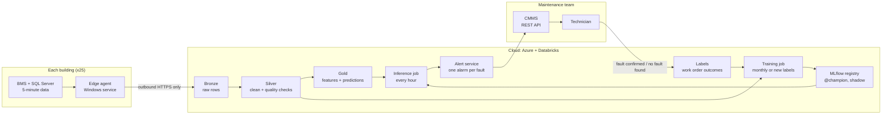

# Architecture

Back to the [project map](00%20-%20Project%20map.md).

How I would run this in production for 25 buildings (about 600 AHUs) in the first year, growing to 2,000 AHUs. The short version, with the diagram, is section 3 of the report (`report/03_architecture.md`, next to this docs folder). This note adds the details that don't fit there.

In plain words: each building has a small "postman" that sends its data out to the cloud every 15 minutes. In the cloud, the data is cleaned, the model looks at it every hour, and if a machine has a fault, a work order goes to the technicians. When the technician closes the order ("fault confirmed" or "no fault found"), that answer goes back to the model as a new example to learn from.

## The flow

## From this repository to production

Most pieces already exist here in a small form. Production is mostly the same code, run on a schedule:

| In this repository | In production |
|---|---|
| `clean_sensors()` (notebook 02) | Quality checks in the step from bronze to silver, with a log of what was fixed |
| `add_features()`, `with_deviations()` | Gold layer job; each AHU's normal recomputed with every training |
| `evaluation.py` (event-level scorer, time blocks) | The gate a challenger must pass before it becomes champion |
| `artifacts/lgbm-v<version>/` (model + model card) | MLflow run and registered model version, alias `@champion` |
| `postprocess.py` (one alarm per fault, joining pieces) | The first steps of the alert service |
| `rules.py` | The detector for new buildings, before they have their own labels |
| `EXTRA_LABELS` (the fault I found without a work order) | Labels from the CMMS outcomes, read every day |

## Technology choices

| Choice | Why | Main alternative |
|---|---|---|
| Azure | The buildings run Windows and SQL Server, so the client most likely already has Microsoft accounts, identity and support | AWS or GCP: fine, nothing here depends on Azure-only services except identity |
| Databricks | Delta tables, scheduled jobs, MLflow and a model registry with aliases in one place. I ran this exact pattern in production in my last project, so delivery risk is low | Containers (Azure Container Apps jobs) + Parquet in blob storage + managed MLflow: cheaper at this size, more pieces to glue |
| Python edge agent | Same language as the rest; a Windows service is easy to install and update; outbound HTTPS only | Azure IoT Edge or Data Factory self-hosted runtime: more features, heavier to install on 25 different PCs |
| Hourly batch inference | Faults last days, alarms need 2 hours, the lying thermometer only shows at night | Streaming every 5 minutes: more cost, no real gain for a visit the next day |
| LightGBM + physics rules | Results of Question 2: fewest false alarms and right fault type | See `04 - Modelling.md` |

## Environments and deployment

The same branch flow as this repository: `feature/*` into `develop`, then `qa`, then `main`. Each branch is deployed with Databricks Asset Bundles to its workspace (dev, QA, production). Each environment trains its own model on its own data and has its own registry; models are never copied from one environment to another, only code moves. A release to production is a tag, like `v0.2.0` or `v1.0.0` here.

## Data quality gate

Every building's batch gets a result before inference: **pass**, **warn** or **block**.

| Result | Example | What happens |
|---|---|---|
| Pass | Normal data | Inference and alerts as usual |
| Warn | A few frozen sensors, a short gap | Inference runs; the affected signals are empty; a "sensor issue" ticket |
| Block | Clock shifted, half the rows missing, wrong units on most AHUs | No new alerts for that building until the data is fixed; ticket to the site IT contact |

Bad data must never become a false alarm. In my last project this gate was the top item left for later; here it is part of the first version.

## Edge agent

- Reads only the new rows (a "last timestamp" watermark per table), every 15 minutes.
- Sends compressed batches over HTTPS to an ingestion endpoint, with a token per site (rotated, stored in the Windows credential store).
- Buffers up to 7 days on disk if the connection fails, then sends in order.
- Sends a small heartbeat every 15 minutes, even with no new rows, so monitoring can tell "no data" from "agent down".
- Needs read-only access to the trend tables. No inbound port, no model, no business logic.

## Alerting rules

| Rule | Value | Why |
|---|---|---|
| Model confidence | 80% or more | Tested in notebook 05 (test B) |
| Minimum alarm | 2 hours of running | Short alarms are flicker or storms |
| Join pieces | up to 6 hours of running apart | One fault, one work order (test C) |
| No alarms after start-up | first 30 minutes | Every start looks like a fault (notebook 03) |
| Suppression | 14 days after "no fault found", same AHU and fault | Don't send the technician twice for the same thing |
| Severity | high: stuck tap, weak radiator, stuck flap in the hospital; medium: lying thermometer, other stuck flaps | Energy and comfort now vs can wait a few days |
| Sensor issues | separate ticket type | A frozen or missing sensor is not one of the four faults (notebook 02) |
| Closing | after 24 hours of running back to normal, with a note on the work order | Old alarms must not stay open (another lesson from my last project) |

## Monitoring

| What | Signal | Action |
|---|---|---|
| Data | no heartbeat for 1 hour, more than 5% missing rows in a day, failed quality checks | Ticket to the site IT contact |
| Sensors | frozen sensor (6 hours flat), CO2 at the sensor limits, clock shift | "Sensor issue" ticket |
| Model | alarms per AHU per month above 0.2 (4 times the validation rate), share of "no fault found" above 30%, feature drift | Review the site; raise its threshold; retrain |
| Jobs | failed or late runs | Alert to the data team |

All of it in one Databricks SQL dashboard, reading from MLflow and the alert tables: champion and challenger versions and their scores, alarms by type and building, share confirmed by technicians, drift of the main features, data gate results.

First month after go-live: two weeks in shadow mode, then alerts with a weekly review with the facilities manager.

## Onboarding a new building in under a week

| Day | Step |
|---|---|
| 1 | Install the edge agent, create its token, check the first rows arrive |
| 2 | Map the BMS point names to the standard names (one template per BMS vendor); fill the AHU metadata (design airflow, fan rating, sensors fitted) |
| 3 | Load the history already in SQL Server; run the quality checks on it |
| 4-5 | With 2+ weeks of history: learn each AHU's normal and start the physics rules in shadow mode. Without it: rules wait until 2 weeks of data arrive |
| Later | Once the building has its own confirmed work orders, retrain the model with them and move to the model + rules combination |

The two weeks to learn each machine's normal come from Question 2 (new building test). Most BMS keep months of trend history, so in practice the normal can be learned on day 3.
