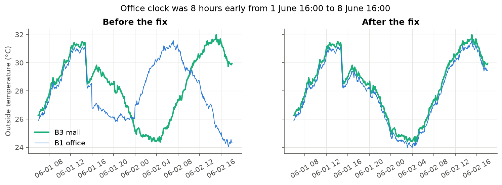
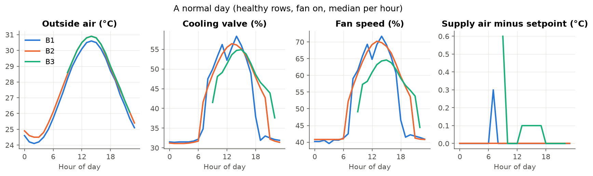
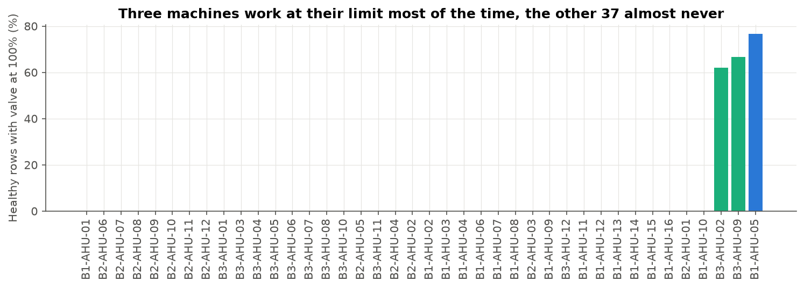
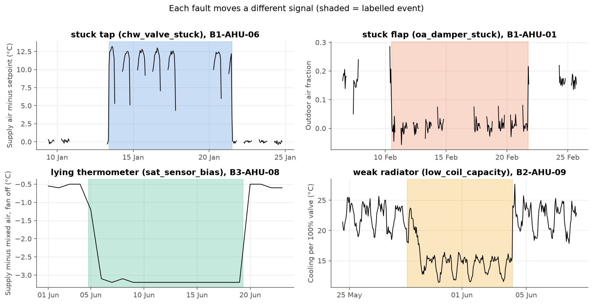

# 1. Data exploration and data quality

## 1.1 My approach

I worked in four steps, one notebook each (`code/notebooks/01` to `04`), and turned every fix into a tested function in `src/ahu_fdd/` so the model and production use exactly the same cleaning:

1. **What is in the data** (`01_data_overview`): the four files, coverage per machine, real against declared schedules, the labels.
2. **Can I trust it** (`02_data_quality`): every problem I found, how I proved it and how I fixed it. `clean_sensors()` runs all fixes in order, on train and test.
3. **What a healthy machine looks like** (`03_patterns`): only rows with the fan on and no fault label, because a fault is a change from normal.
4. **How each fault shows** (`04_faults`): the physics I expect, checked against the 28 labelled events, compared with the healthy rows of the same machine.

The data covers 40 AHUs in three buildings: an office (B1, 16 units), a hospital (B2, 12 units, 24/7, with CO2 and airflow) and a mall (B3, 12 units, no extra sensors). There are 2.05 million rows in train and 0.71 million in test. Only rows with the fan on are scored, and in those, faults are 2.4% of the rows: 28 events in 21 machines, 6 to 8 per fault type, lasting 2 to 15 days. **Assumption:** the brief says UTC+8 but not where. The office closed on exactly the seven weekdays that are Singapore 2025 public holidays, so I assume Singapore.

## 1.2 Data quality

Each building had its own problem, the same in all its machines, which points to how each BMS stored or exported the data, not to broken sensors. The test period is clean apart from one frozen sensor.

| Problem | How I found it | What I did | What I would ask the client |
|---|---|---|---|
| **Office week stamped 8 hours early** (B1, 1 to 8 June): duplicates on 1 June, a hole on 8 June, the office "running at night" | The three buildings share the same weather. The office outside temperature matches the mall exactly 8 hours later (0.4 °C gap) and not at the same time (3.6 °C); trying every offset from -12 to +12 h, the best is +8 | Moved the block 8 hours later (`fix_clock_shift()`); 13 rows with an unknown clock dropped | Did the BMS change its time settings in early June? |
| **One mall day saved twice** (B3, 14 February) | 3,439 duplicate pairs; 97.9% identical, the rest differ only by an empty value | Kept one row and filled empty values from the other copy (`merge_duplicates()`) | Was the data joined from overlapping exports? |
| **Hospital outage** (B2, 10 to 18 March, 200 hours, all 12 units at once) | Joined missing slots into blocks: one long block, all other gaps are 5-10 minutes | Left as a gap; no label falls in it | Was the BMS or its network down? |
| **Fan power in watts** (B3-AHU-04, 1 to 21 April) | Power 1,000 times the rated power of the fan, with the fan on and off | Divided by 1,000 (`fix_power_units()`) | Was the meter changed in April? |
| **CO2 glitches** (B2-AHU-03, January and February) | 781 readings at exactly 0 or 5,000 ppm, the limits of the sensor | Set to empty (`blank_co2_limits()`) | Was this sensor checked? |
| **Frozen sensors**: return air of B1-AHU-07 (22 days, train), supply air of B2-AHU-08 (9 days, test) | Longest run of exactly the same value: normal sensors never stay flat over 1.5 hours | Readings flat for 6 hours or more set to empty (`blank_frozen()`) | Why did these sensors stop updating? |
| About 0.2% empty values in five sensors | Share of empty values per sensor and building | Kept empty | |

The frozen supply air sensor in **test** matters most: it reads 13.1 °C, 0.1 °C above its setpoint, so the machine looks perfect. It is not one of the four faults, so the model must not raise an alarm there.

{width=78%}

## 1.3 Patterns across buildings and units

- **A normal day.** The valve and the fan follow the outside temperature and the people inside: the valve is about 30% at night and 60% in the afternoon, with a dip at lunch in the office. The supply air stays near its setpoint.
- **Setpoints differ between machines** (12.5 to 14.5 °C), but each machine has a fixed one. So I always use the error `sat_c - sat_sp_c`, never `sat_c` alone.
- **Start-up looks like a fault.** In the first 15 minutes after the fan starts, the supply air is about 5 °C above its setpoint; after 30 minutes it is on target. I don't raise alarms in the first 30 minutes.
- **Afternoon storms,** about two per week: outside air drops 3 °C in minutes and the valves close a little. Smoothing over hours handles them.
- **Three machines are always at their limit** (B1-AHU-05 lobby, B3-AHU-02 cinema foyer, B3-AHU-09 retail): valve at 100% in 60-80% of their healthy rows, every month, in train and test, with the supply air about 2 °C too warm. They are labelled normal. A global threshold would raise an alarm on them every day, so **every feature compares a machine with its own normal**.
- **Normal drifts:** filters get dirty for months and are then replaced (B1-AHU-05: from 245 to 95 Pa on 1 July). I validate in time order and don't use absolute filter or fan power values.
- **Test looks like train:** Singapore has almost no seasons; July and August are 0.3 °C warmer.

{width=100%}

{width=70%}

## 1.4 The four faults: physics and labels

I compared each labelled event with the healthy rows of the same machine. Every fault leaves a different fingerprint, which is what a model needs to tell them apart. (In the notebooks and figures I also use plain names, easier to explain to non-technical people: *stuck tap*, *stuck flap*, *weak radiator* and *lying thermometer*.)

| Fault | What should change, and why | What the labelled data shows |
|---|---|---|
| Stuck chilled water valve (`chw_valve_stuck`) | The valve no longer follows its command, so the supply air goes off target and the controller pushes the command to a limit | Supply air 4 to 12 °C too warm (stuck nearly closed) or about 5 °C too cold (stuck open); command at 0% or 100% in 99% of the rows |
| Stuck outdoor air damper (`oa_damper_stuck`) | No outdoor air: mixed air equals return air. By the mixing formula, the outdoor air share x = (MAT - RAT) / (OAT - RAT) drops to 0, and CO2 rises | Outdoor air share from 0.10-0.20 to almost 0; flap command +40 points (the controller tries to compensate); CO2 +440 to +1,030 ppm where there is a sensor |
| Low coil capacity (`low_coil_capacity`) | The coil cools less for the same valve opening, so the controller opens the valve more | Valve about 20 points above what the same machine needs for the same cooling work; supply air stays on target until the valve reaches 100% |
| Supply air sensor bias (`sat_sensor_bias`) | The controller trusts the sensor, so the reading stays on target while the real air is too warm or too cold. Nothing shows while the fan runs | With the fan off for an hour, supply and mixed air should read the same: normally -0.5 °C, during the six events +2.0 to +2.4 °C or -2.5 to -3.2 °C |

{width=92%}

**Do the labels agree?** Yes. For the stuck valve and damper, the fingerprint starts and ends within an hour of the work order dates; the bigger gaps at the end of office events are weekends (the fan is off from Friday to Monday). The sensor bias is seen 11 to 41 hours late, because the check needs the fan off at night.

**Looks like a fault but is not labelled:**

- **B1-AHU-11, 22 to 30 April:** a textbook stuck damper (outdoor air share near 0, flap command 70% instead of 15%, CO2 from 980 to 1,700 ppm), and on 30 April at about 16:00 the data shows the repair: outdoor air comes back and CO2 drops in half an hour. There is no work order. I added it as a training label, because leaving it as normal would teach the model that a stuck damper is healthy.
- The three machines always at their limit look like a permanent low coil capacity, but I treat them as normal (undersized units), as the client labels them.

**Labelled but hard to see:**

- The sensor bias on machines that never switch off (the hospital and two office units): the check at rest is impossible there.
- A stuck valve or low coil capacity on the three machines at their limit: their valve is already at 100%, so the fault hides in their daily struggle (B3-AHU-09's stuck valve is hard to separate from its normal).
