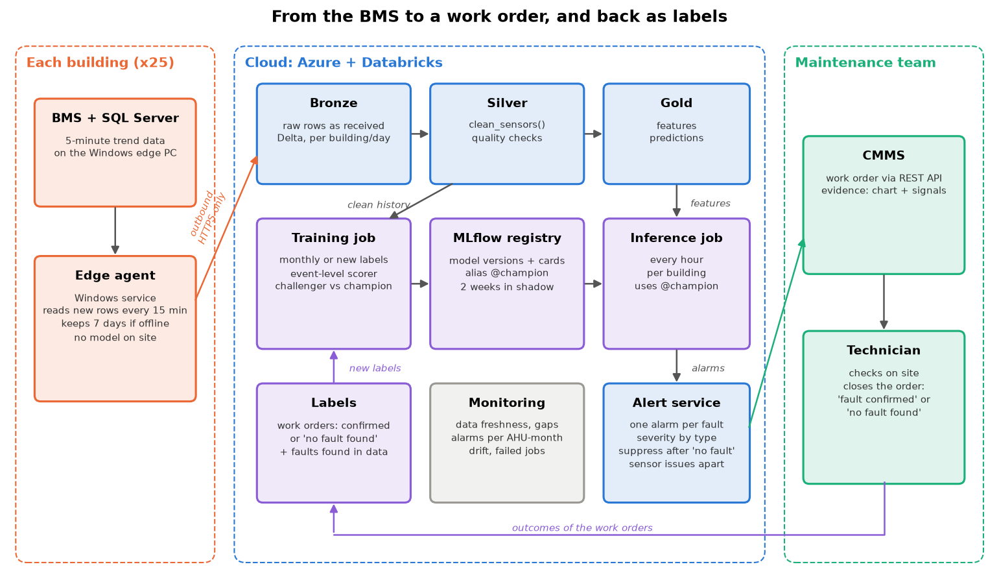

# 3. System architecture

The goal is to run the model of Question 2 for 25 buildings (about 600 AHUs) in the first year, and to send the technicians work orders they can trust. I chose **Azure with Databricks**: the buildings already run Windows and SQL Server, and it is the stack I used in production for a similar ML system (Delta tables, scheduled jobs, MLflow with a champion model). The lighter option, containers with Parquet files and a managed MLflow, would also work and cost less; I would pick it if the client has no Azure.

## Data ingestion and storage

- **At the edge:** a small Python agent runs as a Windows service on each edge PC. Every 15 minutes it reads the new rows from SQL Server (by last timestamp) and sends them over **outbound HTTPS** to an ingestion endpoint, with a token per site. If the connection fails, it keeps up to 7 days on disk and sends them later. Nothing listens on site, so no inbound connection is needed. The model does **not** run at the edge: one place to update it, and the edge PC is the least reliable part.
- **Storage:** three layers in Delta tables, partitioned by building and day. **Bronze** keeps the rows exactly as received, so I can always rebuild. **Silver** is the cleaned data (`clean_sensors()`). **Gold** has the features and the predictions.
- **Data quality:** the problems I found in Question 1 become automatic checks in the step to silver: clock shift (outside temperature compared with a neighbour building), duplicate rows, outages, wrong units, sensor limits and frozen sensors. A failed check fixes what it can and logs the rest. A frozen sensor raises a **"sensor issue"** ticket, kept apart from fault alarms, because it needs a different fix.

## ML lifecycle

- **Training** runs once a month, or earlier when new confirmed work orders arrive. It uses the same code as the notebook: the time-block validation and the event-level scorer (faults found, right type, delay, false alarms per AHU per month).
- **Versioning:** every run is logged in MLflow (data period, code commit, parameters, scores) and registers a new model version with its model card, like the `artifacts/` folder of this repository.
- **Champion and challenger:** a new version (challenger) replaces the current one (champion) only if it passes **two gates**: a minimum level (for example, at least 90% of faults found and at most 0.1 false alarms per AHU per month) **and** a better score than the champion on the same validation data. Then it runs **two weeks in shadow mode**, predicting without sending alerts, and its alarms are compared with what the technicians find. Rolling back means moving the `champion` alias back to the old version.
- **Labels from the field:** every day the system reads the closed work orders from the CMMS API. "Fault confirmed" becomes a label for that fault and period; "no fault found" becomes a normal label and a measured false alarm. This is the most important data for the next model: today I have only 29 events, and one of them I had to add myself (Question 1).

## Inference strategy

**Every hour, per building.** Faults last days, an alarm needs at least 2 hours of evidence, and the lying thermometer can only be checked at night with the fan off. Running every 5 minutes would cost more and only find faults a few minutes earlier, which doesn't change anything for a technician who visits the next day. Each run uses the last 48 hours of data, so the rolling features are complete.

## Alerting and integration

The alert service turns predictions into work orders, and its job is to protect the technicians' trust:

- **One alarm per fault:** the pieces of the same fault are joined (the morning start-up doesn't split it) and an open alarm is updated, not repeated.
- **Severity by type and building:** a stuck tap or a weak radiator wastes energy and comfort now (high); a lying thermometer or a stuck flap can usually wait a few days (medium), except a stuck flap in the hospital, where fresh air matters for patients (high).
- **Suppression:** after "no fault found", the same fault on the same AHU is silenced for 14 days, unless the signal gets clearly worse.
- **Work order:** created through the CMMS REST API, with the evidence: a small chart of the signals that triggered it and the plain fault name, so the technician knows what to check first.
- **Feedback:** the outcome of each order flows back as a label (see above).

## Monitoring

- **Data:** freshness per building (an agent that stopped sending), share of missing rows, failed quality checks, frozen sensors.
- **Model:** alarms per AHU per month against the expected rate (0.05 in validation), share of alarms confirmed by technicians, and drift of the main features (for example, filters slowly change the fan signals).
- **Jobs:** failed or late runs.

**First month after go-live:** the model runs in shadow for the first two weeks, then sends alerts with a weekly review with the facilities manager. If a site raises too many alarms, I raise its confidence threshold or minimum alarm length for that site before going further.

## Scale and onboarding

- **Scale:** 2,000 AHUs are about 600,000 rows a day, under 100 MB. Jobs run per building and in parallel, so growing means more small jobs, not a bigger system. The models are small LightGBM files.
- **A new building in under a week:**
  - Day 1: install the agent and its token.
  - Day 2: map the BMS point names to the standard names (one template per BMS vendor) and fill the AHU metadata (size, sensors).
  - Day 3: load the history already stored in SQL Server, and run the quality checks.
  - Days 4-5: if there are at least two weeks of history, learn each AHU's normal and start the **physics rules** in shadow mode. Otherwise the rules wait until two weeks of data arrive.
- **Why rules first:** in Question 2, a model trained on other buildings found only 50-60% of the faults in a building it had never seen, while the rules found all of them. The model takes over once the building has its own confirmed work orders.
