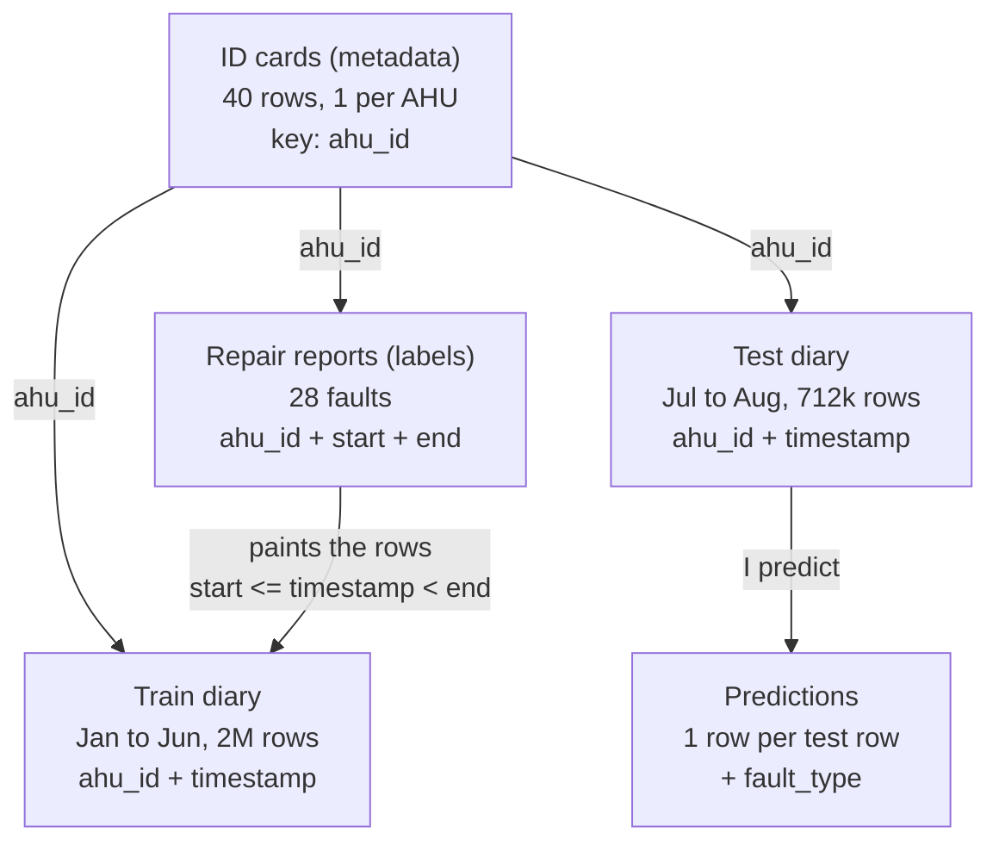
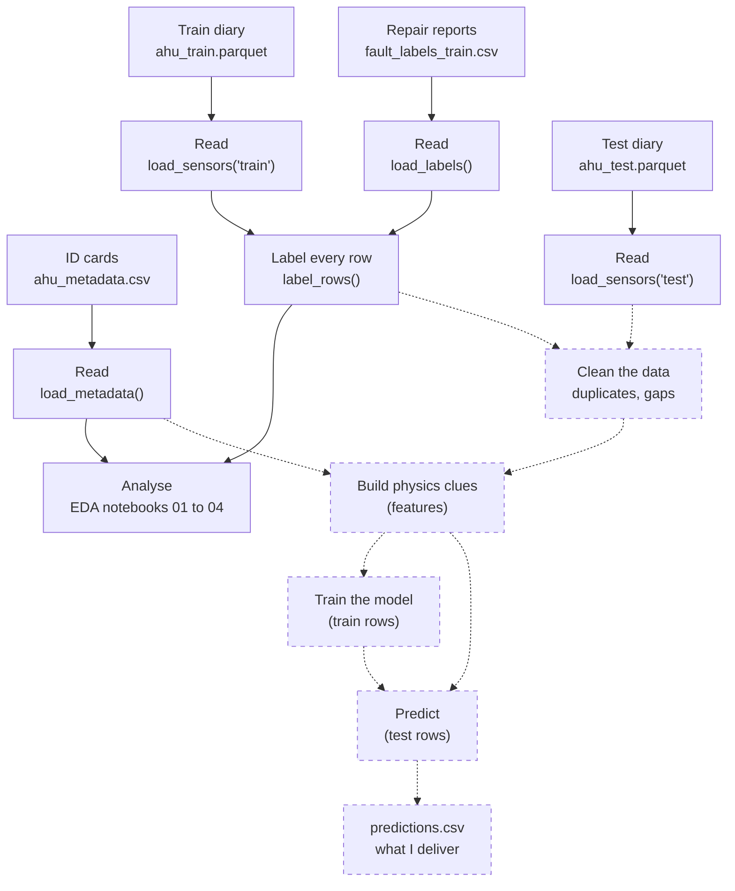
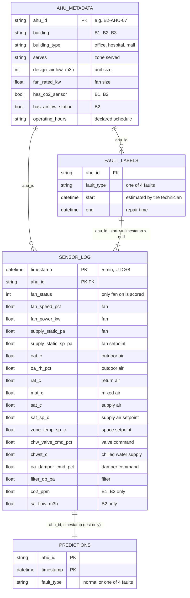

# Data

Back to the [project map](00%20-%20Project%20map.md).

This note explains the four data files in plain words: what each one is, what it looks like, how they connect, and how the data moves through the code. If you don't know what an AHU is yet, read [AHU physics and faults](03%20-%20AHU%20physics%20and%20faults.md) first.

The client data is not in the repository. The code reads it from the folder set in `config.py` (or `AHU_DATA_DIR`).

## The four files, like the papers of a car garage

| File | Garage example | What it is | Rows |
|---|---|---|---|
| `ahu_metadata.csv` | **The ID card of each car** | One row per machine: what it is like | 40 |
| `ahu_train.parquet` | **The "black box" of each car** (January–June) | What the sensors measured, every 5 minutes | 2,053,533 |
| `fault_labels_train.csv` | **The garage repair reports** | The confirmed faults: which machine, which fault, from when to when | 28 |
| `ahu_test.parquet` | **The black box for July–August, without the repair reports** | Same as train, but nobody tells me which faults happened. **I have to find them** | 711,994 |

### 1. `ahu_metadata.csv`: the ID card of each machine

One row per AHU, with the facts that don't change:

| ahu_id | building | building_type | serves | design_airflow_m3h | has_co2_sensor | has_airflow_station | operating_hours |
|---|---|---|---|---|---|---|---|
| B1-AHU-01 | B1 | office | meeting rooms | 15000 | True | False | Mon-Fri 07:00-19:30 except public holidays |
| B3-AHU-02 | B3 | mall | cinema foyer | 38000 | False | False | Daily 09:00-23:00 |

- `ahu_id` is the "ID number" of the machine. `B3-AHU-02` means building B3, machine number 2.
- It says which building, which zone it serves, **how big it is** (how much air it moves, `design_airflow_m3h`, and its fan size, `fan_rated_kw`) and **which extra sensors it has**.

The three buildings:

| Building | Type | AHUs | When it runs | Extra sensors | Size (m³/h) |
|---|---|---|---|---|---|
| B1 | Office | 16 | Mon–Fri 07:00–19:30, closed on public holidays. Two units 24/7 | CO2 | 12,500 – 30,000 |
| B2 | Hospital | 12 | 24/7 | CO2, airflow | 6,000 – 20,000 |
| B3 | Mall | 12 | Every day 09:00–23:00 | none | 25,000 – 44,500 |

The machines are very different in size (a mall unit moves up to 7 times more air than a small hospital unit), so I can't compare raw values between machines.

### 2. `ahu_train.parquet`: the diary of each machine

**One row per machine every 5 minutes**, like a photo of all its sensors at that moment:

| timestamp | ahu_id | fan_status | sat_c | sat_sp_c | mat_c | rat_c | chw_valve_cmd_pct | … |
|---|---|---|---|---|---|---|---|---|
| 2025-03-10 10:00 | B3-AHU-01 | 1 | 13.5 | 13.5 | 24.5 | 23.9 | 45.8 | … |
| 2025-03-10 10:05 | B3-AHU-01 | 1 | 13.5 | 13.5 | 24.5 | 24.1 | 47.4 | … |

These are real rows: a healthy mall machine on a Monday morning. The air goes out at 13.5 °C, exactly its target, with the tap at about 46%.

40 machines × one row every 5 minutes × 6 months ≈ 2 million rows. Time is local (UTC+8). Rows are also logged when the machine is off, but only rows with the fan on are scored.

The columns are the "vital signs" of the machine, in the order the air goes through it:

| Group | Plain meaning | Columns |
|---|---|---|
| Is it on? | Fan running (1) or not (0) | `fan_status` |
| Outside | Temperature and humidity outside | `oat_c`, `oa_rh_pct` |
| Back from the rooms | Temperature of the air coming back, and its CO2 (office and hospital only) | `rat_c`, `co2_ppm` |
| The flap | How much the control asks the outdoor-air flap to open. It's the **order**, not the real position | `oa_damper_cmd_pct` |
| Mix | Temperature after mixing outside and room air | `mat_c` |
| Filter | How dirty the filter is (pressure drop) | `filter_dp_pa` |
| Cold radiator | How much the control asks the cold water tap to open (the **order** again), and the temperature of the cold water | `chw_valve_cmd_pct`, `chwst_c` |
| Fan | Speed, power, duct pressure and its target | `fan_speed_pct`, `fan_power_kw`, `supply_static_pa`, `supply_static_sp_pa` |
| Air to the rooms | Temperature of the cold air going out and its target, and the airflow (hospital only) | `sat_c`, `sat_sp_c`, `sa_flow_m3h` |
| Rooms | Target temperature in the rooms | `zone_temp_sp_c` |

### 3. `fault_labels_train.csv`: the repair reports

One row per **fault confirmed on site by a technician**:

| ahu_id | fault_type | start | end |
|---|---|---|---|
| B3-AHU-09 | chw_valve_stuck | 2025-01-16 06:25 | 2025-01-18 13:25 |
| B3-AHU-02 | sat_sensor_bias | 2025-03-06 03:05 | 2025-03-15 14:15 |

Read the first row as: *"Machine B3-AHU-09 had a stuck tap from 16 January at 06:25 until it was repaired on 18 January at 13:25."*

- Only **28 faults** in 6 months, in 21 of the 40 machines.
- `start` is the technician's **best guess**. Nobody knows the exact minute it began.
- Some faults may **never have been reported**.

| Fault | Plain name | Events | Typical length | B1 | B2 | B3 |
|---|---|---|---|---|---|---|
| `chw_valve_stuck` | Stuck tap | 8 | 5.6 days | 2 | 2 | 4 |
| `low_coil_capacity` | Weak radiator | 7 | 4.3 days | 3 | 3 | 1 |
| `oa_damper_stuck` | Stuck flap | 7 | 5.6 days | 4 | 1 | 2 |
| `sat_sensor_bias` | Lying thermometer | 6 | 10.3 days | 1 | 0 | 5 |

### 4. `ahu_test.parquet`: the exam

**Exactly like the train diary, but for July and August, and without repair reports.** My job is to look at this data and say, for every row, whether the machine is **normal** or has **one of the four faults**. That is the `predictions.csv` file I deliver.

## How the tables connect

### The common key: `ahu_id`

All four tables talk about the same 40 machines, and all of them have the column `ahu_id`:



### The special link: repair reports ↔ diary

This is the only link that is not a normal join. A repair report has **no matching row** in the diary. It covers **a range of time**, so I "paint" every diary row that falls inside it:

```text
Report: B3-AHU-09, stuck tap, from 16 Jan 06:25 to 18 Jan 13:25

Diary of B3-AHU-09:
  16 Jan 06:20  →  normal
  16 Jan 06:25  →  chw_valve_stuck   ◀─┐
  16 Jan 06:30  →  chw_valve_stuck     │  every row between
  ...                                  │  start and end
  18 Jan 13:20  →  chw_valve_stuck   ◀─┘
  18 Jan 13:25  →  normal  (already repaired)
```

That is what `label_rows()` in `data.py` does: it gives every diary row a label, the fault name if it falls inside a report (`start <= timestamp < end`) or `normal` if not. This turns "28 reports" into "2 million labelled rows", which is what I can analyse and train on.

## Data flow: how the data moves through the code

Solid boxes are built. Dashed boxes are planned.



1. **Read** the four files (`load_metadata`, `load_sensors`, `load_labels`). Done.
2. **Label** every train row with its fault or `normal` (`label_rows`). Done.
3. **Analyse** the data in the notebooks to understand it and find problems. Phase 1, in progress.
4. **Clean** the data (duplicates, gaps) and **build clues** based on the physics, for example "how close is the mixed air to the room air?", which points to a stuck flap. Phase 2.
5. **Train** a model on the train data, where I know the answers. Phase 2.
6. **Predict**: apply the same steps to the test data and write `predictions.csv`. Phase 2.

## Technical view

The same relations as an entity-relationship diagram, with every column:



More detail in `notebooks/01_data_overview.ipynb`.
