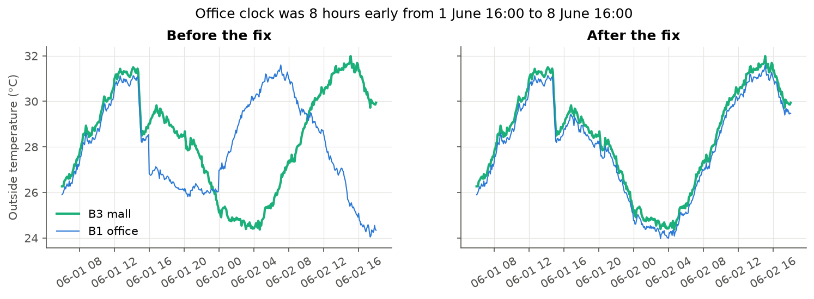

# Data quality

Back to the [project map](00%20-%20Project%20map.md).

Work in progress (phase 1). This note will list each problem found, how I found it, what I did, and what I would ask the client.

First look (from `notebooks/01_data_overview.ipynb`). The diary should work like an attendance list: one row per machine every 5 minutes. In train, each building breaks it in its own way, and in the same way for all its machines:

| Building | Duplicate rows (same time twice) | Missing slots (no row) |
|---|---|---|
| B1 office | In all 16 machines, up to 96 per machine (8 hours), all on 1 June | about 0.5% |
| B2 hospital | none | **about 4.9% in every machine (around 9 days)** |
| B3 mall | In all 12 machines, up to 288 per machine (one full day: 14 February), copies identical in 98% of cases | about 0.3% |

- A problem shared by every machine of a building points to how each BMS exported or stored the data, not to a broken sensor.
- Test is clean: no duplicates and about 0.3% missing slots everywhere.
- About 0.2% nulls in some sensors in train, none in test.

## One office week stamped 8 hours early

From 2 to 8 June, the office (B1) data is saved in UTC instead of Singapore time (UTC+8). In plain words: the clock of the office diary was 8 hours early that week.

- The office seems to run from 23:00 to 11:30 instead of 07:00 to 19:30, and the outside temperature peaks around 07:00 instead of 14:00.
- Where the shifted block starts, 8 hours of 1 June appear twice with different values: these are the 96 "duplicates" per office machine. Where it ends, 8 June has an 8-hour hole.
- The mall runs normally that week, so it only affects the office.
- Proof (`notebooks/02_data_quality.ipynb`, section 1): the three buildings share the same weather. In that week the office outside temperature matches the mall temperature 8 hours later (0.4 °C gap), not at the same time (3.6 °C gap). Trying every offset from -12 to +12 hours, the best one is exactly +8.
- In each duplicate pair, the first copy in the file is the real 1 June evening and the second copy is the early-clock 2 June night.
- Fix: `fix_clock_shift()` in `src/ahu_fdd/data.py` adds 8 hours to the office rows stamped from 1 June 16:00 to 8 June 16:00 (only the second copy in the first 8 hours). 13 stamps in those first 8 hours have only one row, so I can't tell which clock they belong to: I drop them. The limits are in `config.py`.
- Result: no office duplicates left, missing slots drop from 0.5% to 0.3%, and the 8 June hole is filled. Only the 13 ambiguous rows are dropped. No office fault event falls in that week.

