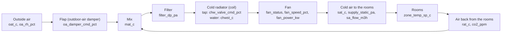

# AHU physics and faults

Back to the [project map](00%20-%20Project%20map.md).

This note explains, in plain words, how the air works in these buildings and what each fault means. The technical details come after the simple version.

## The problem: keep a hot building cool

Think of a shopping mall in Singapore. Outside it is about 30 °C and very humid all year. Inside there are thousands of people, lights and shop windows that also give off heat. To keep people comfortable (about 24 °C), the building has to cool its air all the time.

## The solution: the AHU, the "lungs" of the building

An AHU (air handling unit) is a big machine, about the size of a van, on the roof or in the basement. Its job is to take air, cool it and send it to the rooms through the ducts in the ceiling. The grilles you see in a mall ceiling are where that air comes out.

A big building has several AHUs, each one for a zone. In this data the mall has 12: one for the cinema foyer, one for the food court, one for the shops on level 1, and so on. In total there are 40 AHUs in three buildings (an office, a hospital and a mall).

It works like the air conditioning of a car, just much bigger.

## What the AHU does, step by step

1. **Mix.** The machine takes the used, slightly warm air coming back from the rooms and adds a little air from outside to renew it. Without fresh air, CO2 would go up and people would feel stuffy. A **flap** (the outdoor-air damper) decides how much outside air comes in. Outside air in Singapore is very hot, so the flap stays mostly closed, like the "recirculate" button in a car.
2. **Filter.** Cleans the dust. Over time it gets dirty and the air has a harder time passing through.
3. **Cold radiator** (the cooling coil). A radiator with very cold water inside (about 7 °C) that comes from a central plant in the building. The air passes through it and cools down. A **tap** (the chilled-water valve) sets how much cold water goes through: more open tap, colder air.
4. **Fan.** Pushes the air through the ducts to the rooms.
5. **Cold air to the rooms**, at about 13–14 °C. It mixes with the room air and keeps the room at about 24 °C. Then that air goes back to the machine and the cycle starts again.

The whole path, with the data columns in each box:

| Step | Plain name | Technical name | Columns |
|---|---|---|---|
| 1 | Mix, with the flap | Mixing box, outdoor-air damper | `oat_c`, `oa_rh_pct`, `rat_c`, `oa_damper_cmd_pct`, `mat_c`, `co2_ppm` |
| 2 | Filter | Filter | `filter_dp_pa` |
| 3 | Cold radiator, with the tap | Chilled-water coil and valve | `chw_valve_cmd_pct`, `chwst_c` |
| 4 | Fan | Supply fan | `fan_status`, `fan_speed_pct`, `fan_power_kw` |
| 5 | Cold air to the rooms | Supply air | `sat_c`, `sat_sp_c`, `supply_static_pa`, `supply_static_sp_pa`, `sa_flow_m3h` |

## The two automatic "thermostats"

The machine has two automatic controls, like the thermostat at home:

| Control | What it watches | What it moves | Example |
|---|---|---|---|
| Temperature control | The temperature of the air going out (`sat_c`) | The **tap** of cold water (`chw_valve_cmd_pct`) | "The air goes out at 15 °C and I want 13 °C (`sat_sp_c`), so I open the tap more" |
| Pressure control | The pressure inside the duct (`supply_static_pa`) | The **fan speed** (`fan_speed_pct`) | "The pressure is too low, so I speed up the fan" |

**The key to understanding the faults:** the data stores what the control **asks for** ("open the tap to 80%"), not what the part really does. If the tap is stuck, the control keeps asking but nothing changes. **Finding a fault means catching that contradiction between what is asked and what happens.**

A few more things to know:
- In the office and the hospital, the flap also opens more when CO2 goes up (more people, more fresh air needed).
- When the fan is off, no air moves and the sensor values mean little. Only rows with the fan on are scored.

## The four faults, in plain words

Each fault is one part of the machine failing. I give each one a plain name to remember it:

| Plain name | Label in the data | What breaks | Everyday example | How it should show in the data |
|---|---|---|---|---|
| **Stuck tap** | `chw_valve_stuck` | The cold water valve | A shower tap that doesn't turn: you move the handle and the water stays the same | The control asks for more or less cooling, but the air temperature doesn't change. The command often ends at 0% or 100%, trying to fix it |
| **Stuck flap** | `oa_damper_stuck` | The outdoor-air damper, stuck nearly closed | A car window that won't open: you want fresh air and none comes in | The mixed air is the same as the air coming back from the rooms, because no outside air enters, even if the flap is told to open. In the office and the hospital, CO2 goes up |
| **Lying thermometer** | `sat_sensor_bias` | The supply air temperature sensor | A home thermometer that reads 2 degrees too low: the heating thinks it's cold and heats too much | Tricky: the control trusts the sensor, so everything looks perfect. I have to catch it indirectly: the tap is more open (or closed) than usual for the load, the cooling across the coil doesn't match, or the rooms are colder or warmer than expected |
| **Weak radiator** | `low_coil_capacity` | The cooling coil (dirty, air inside, a valve half closed) | A home radiator with air inside: you open it fully and it barely gets warm | The tap is very open and the air still doesn't get cold enough, mostly when it's hot outside or the building is full |

Two questions to keep apart:
- **Detection:** is something wrong?
- **Diagnosis:** what is wrong?

Some faults can look alike with these sensors. A stuck tap and a weak radiator can both end with "tap very open, air not cold enough". If the data can't separate them, I say it.

To be checked against the labelled events in `notebooks/04_faults.ipynb` (phase 1).

## A bit of physics: the mixing formula

The mixed air (`mat_c`) is a mix of outside air (`oat_c`) and air from the rooms (`rat_c`). If a share `x` comes from outside:

`MAT = x · OAT + (1 − x) · RAT`, so `x = (MAT − RAT) / (OAT − RAT)`

Example: OAT = 30 °C, RAT = 24 °C and MAT = 25 °C, so x = (25 − 24) / (30 − 24) ≈ 0.17. About 17% of the air comes from outside.

With a **stuck flap**, x stays close to 0 (MAT ≈ RAT) even when the flap is told to open. The formula is in `starter/ahu_utils.py` (`outdoor_air_fraction`). It is unreliable when OAT and RAT are close (less than 2 °C apart), because then a small error in the sensors changes x a lot.

## References

- APAR rules (House et al., NIST, 2001), a classic rule set for AHU fault detection.
- ASHRAE RP-1312 and the LBNL fault detection datasets.
