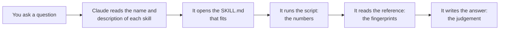

# Claude skills

Back to the [project map](00%20-%20Project%20map.md).

A skill is a written procedure that Claude Code follows, with scripts for the calculations. Think of the procedure binder in a workshop: nobody learns it by heart. You look at the index and open the sheet for the job. This note explains the five skills of this project, how to use them and what I measured.

I added them after the delivery of v1.0.0, so they are not in the ZIP. They live at the root of the repository, in `.claude/skills/`.

## The skills

| Skill | Use it when | Starts | What it gives you |
|---|---|---|---|
| [`ahu-alarm-triage`](../../../.claude/skills/ahu-alarm-triage/SKILL.md) | You want to know what is wrong with a machine | By itself or by hand | A card: diagnosis, confidence, evidence, what to check on site |
| [`fault-sensitivity-test`](../../../.claude/skills/fault-sensitivity-test/SKILL.md) | You want to know how small a fault the detector can catch | By itself or by hand | A table per fault size: found, delay, right type, false alarms |
| [`definition-of-done`](../../../.claude/skills/definition-of-done/SKILL.md) | A change is finished and you want to commit it | By itself or by hand | Tests, lint, missing files, and what was not checked |
| [`notebook-consistency`](../../../.claude/skills/notebook-consistency/SKILL.md) | A notebook was re-run, or results moved | By itself or by hand | Numbers in the text that no output supports |
| [`release-and-package`](../../../.claude/skills/release-and-package/SKILL.md) | You want to publish a version | Only by hand | A release, and a ZIP tested in a clean folder |

## How to use them

There are two ways, both from Claude Code in this repository:

1. **Ask in plain words.** "What is wrong with B1-AHU-11 from 22 April?" Claude compares the question with the description of each skill and opens the one that fits.
2. **Call it by name.** Write `/ahu-alarm-triage B1-AHU-11 2025-04-23 2025-04-29`.

The skills need the project environment and the data, so you can't run the first two without the client data, which is not in this repository. Their logic has unit tests on small synthetic data, and these run in CI.

## How a skill works



Each skill is a folder:

```text
.claude/skills/ahu-alarm-triage/
├── SKILL.md                         # when to use it, the steps, the format of the answer
├── references/fault_fingerprints.md # read only when needed
├── scripts/alarm_evidence.py        # thin command line on top of src/ahu_fdd/triage.py
└── evals/                           # the test cases of the section below
```

I took three decisions in all five:

- **Code gives the numbers, Claude gives the judgement.** Calculations are in scripts or in `src/ahu_fdd/`, so they give the same result every time and have tests.
- **Only the name and description load at the start.** The rest loads when it is needed, so five skills cost almost nothing until one is used.
- **A release needs a person.** `release-and-package` has `disable-model-invocation: true`, so Claude can't start it alone. A tag can't be moved, and the skill asks before each merge.

## What each skill found on the real project

### `ahu-alarm-triage`

For the unlabelled stuck flap on B1-AHU-11, the script gives these numbers (23 to 29 April):

| Signal | Window | Normal | Change |
|---|---|---|---|
| Outdoor air fraction | 0.01 | 0.08 | -0.07 |
| Damper command | 70% | 15% | +55 points |
| CO2 | 1,681 ppm | 975 ppm | +706 ppm |

The stuck flap rule fires on 81% of the running rows, and the other three on 0%. There is no model in this step (`src/ahu_fdd/triage.py`), so a technician can follow each number back to a sensor.

I tested it on six real cases: one per fault, a stuck tap on a machine always at its limit, and a healthy machine. Each answer was graded on four points: right diagnosis, two signals with their normal, a useful check on site, and a confidence level or a limit. The labels stayed hidden from the runs, and Claude could read the code and the physics note in both cases. The cases are in `.claude/skills/ahu-alarm-triage/evals/`.

| Run | Points (of 24) | Right diagnosis (of 6) | Tokens | Time |
|---|---|---|---|---|
| No skill | 19 | 5 | 108,512 | 150 s |
| Skill, first version | 23 | 5 | 73,167 | 56 s |
| Skill, after fixes | 24 | 6 | 73,145 | 55 s |

How to read it:

- Claude was already good without the skill, because the physics note and the data were there. The skill mostly saves effort and gives every answer the same shape: about a third fewer tokens and about a third of the time, with a confidence level and limits each time.
- The first version did not name the fault on B3-AHU-09, a machine always at its limit. Neither did the run with no skill. After the first run I wrote in the reference that the supply air is compared with the machine's own normal, and then it named the stuck tap with medium confidence. This is the case I tuned, so the 6 of 6 is not independent.
- The run with no skill did one thing better: it said when each fault started and ended, and that some had already recovered, so the team should check the work order first. The skill doesn't do that yet, because its evidence is one number per window.

I graded the answers by hand. All runs used Sonnet, one run for the six cases together, so tokens and time are for the whole batch. After the last run I added small notes on the end date and on when to send someone, and I didn't run the cases again.

### `fault-sensitivity-test`

The results are in [Modelling](04%20-%20Modelling.md#how-small-a-fault-can-it-catch). The main one is that a lying thermometer stays hidden on a machine that never stops. All three control runs with no fault were clean.

### `notebook-consistency`

On the 5 notebooks and the report it found no errors or cells out of order. It listed 62 numbers in the notebooks and 13 in the report that appear in no output. I checked six of them against the data (3,439 mall copies, 8.3 days of outage, 2.4% fault rows, 1,860 and 1,020 ppm of CO2, 3,452 rows removed) and they are right. They are numbers read from a chart, or sums made in the text. I did not check the other ones one by one, so this is a list of candidates, not a proof.

### `definition-of-done`

It ran on its own branch and found the files I had not written yet: this note, the changelog and the row in the decisions log.

### `release-and-package`

Its first real use will be v1.1.0. For now I tested two parts. The preflight check correctly stops v1.1.0, because its date, version and links are not ready. The ZIP test on `origin/main` (v1.0.0) rebuilt the same `predictions.csv` in a new environment: 60 tests passed, 1 skipped, and the sha256 is identical. The promotion through the branches is not tested.

## Limits

- The evaluation has six cases and one run for each, and I tuned one of them. It shows the direction, not a statistic.
- The triage doesn't show when a fault started or ended inside the window.
- The skills are written for this repository. The paths and the fault names don't move to another project without changes.
- I didn't tune the descriptions with a trigger test, so a skill may not start by itself on every wording. Calling it by name always works.
- A skill doesn't replace a review. It makes a known procedure repeatable. The decisions stay with me.
